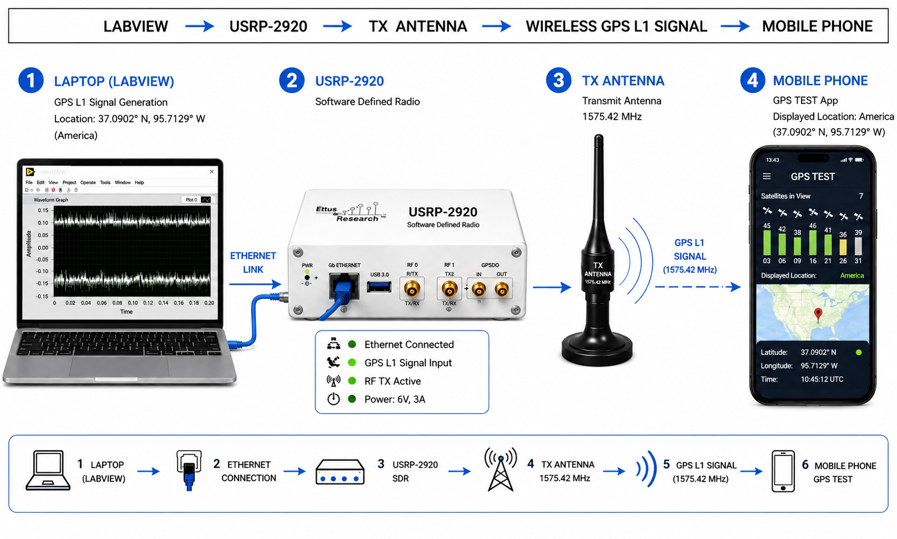
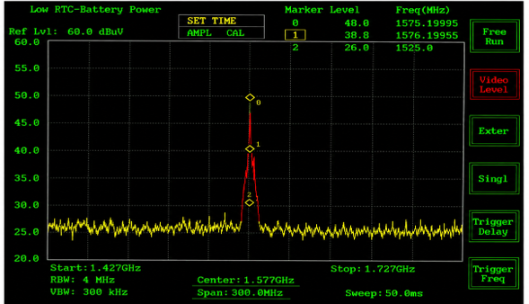
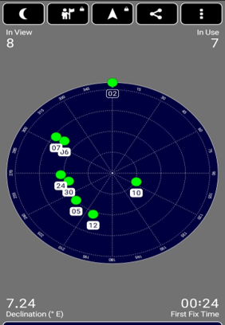
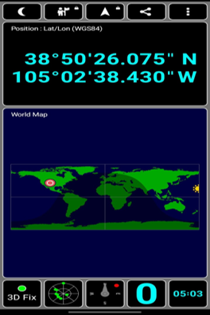
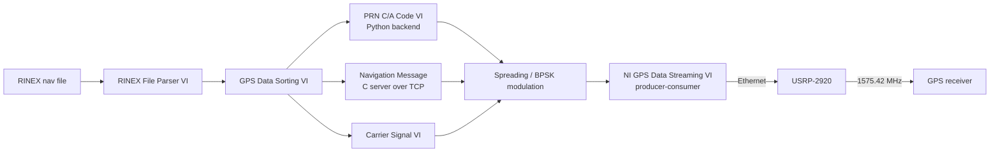
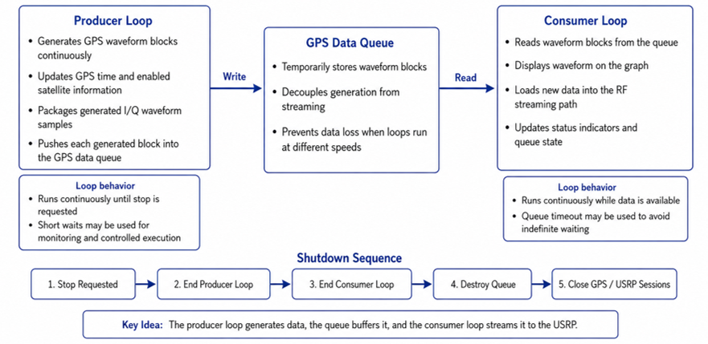

<div align="center">

# GPS L1 Signal Modelling & Transmission via Software-Defined Radio

**A LabVIEW + USRP-2920 pipeline that generates a GPS L1 C/A signal from RINEX navigation data and transmits it to a real GPS receiver in a controlled laboratory setup.**


BS Computer Engineering final year project, COMSATS University Islamabad, Abbottabad Campus (Spring 2026)


<sub>System overview (illustrative diagram)</sub>

</div>

---

## Overview

GPS signals are weak, hard to receive indoors, and cannot be freely transmitted. This project builds a
laboratory testbed that **generates a GPS L1 (1575.42 MHz) C/A signal in software and transmits it with
a software-defined radio**, so receivers and signal-processing ideas can be tested without real satellites.

The signal chain was built as separate LabVIEW modules, each verified on its own, and then integrated and
transmitted through an **NI USRP-2920**. It was validated at three levels: the generated waveform, a
spectrum analyzer measurement, and a real GPS receiver that detected satellites and obtained a 3D fix.

## Results

| Spectrum analyzer | Satellites detected | 3D position fix |
|:---:|:---:|:---:|
|  |  |  |
| Distinct peak near the GPS L1 center frequency (1575.42 MHz) | 8 satellites in view, 7 in use (GPSTest app) | 3D Fix, position matches the configured scenario |

- **Frequency-domain check:** the spectrum analyzer shows a clear peak at the L1 band after transmission through the USRP-2920.
- **Receiver-level check:** a mobile GPS receiver acquired multiple satellites and reported a 3D fix at the scenario location configured in LabVIEW.
- **Generated baseband waveform:** see [`docs/images/generated-waveform.png`](docs/images/generated-waveform.png).

## How it works



1. **RINEX parsing and sorting:** read broadcast ephemeris and organize per-satellite parameters.
2. **PRN C/A codes:** generate the 1023-chip Gold code for the chosen satellite (Python backend called from LabVIEW).
3. **Navigation message:** a C server encodes GPS subframes and streams the 30-bit words over TCP at the real 50 bit/s rate; LabVIEW receives and converts them to bits.
4. **Carrier and modulation:** generate the carrier and BPSK-modulate the spread data.
5. **Integration and transmission:** the NI GPS Data Streaming VI (producer-consumer architecture) streams the waveform to the USRP-2920 over Ethernet.

<details>
<summary>Producer-consumer streaming architecture</summary>



</details>

## Repository structure

```
.
├── labview/
│   ├── File_Parsing_Logic.vi        RINEX File Parser
│   ├── gps data sorting.vi          GPS Data Sorting
│   ├── new-cacode.vi                PRN C/A Code Generator
│   ├── navtcpconversion.vi          Navigation message TCP client and bit conversion
│   ├── CARRIERSIGNAL...vi           Carrier Signal Generation
│   ├── Spreading.vi                 Spreading / modulation stage
│   └── third_party/
│       └── niGPS Direct Streaming.vi  NI GPS streaming VI used for final integration
├── python/
│   └── ca_code_generator.py         C/A code generator (PRN 1-32 to CSV)
├── navmsg-server/
│   ├── navmsg_tcp_server.c          Navigation message TCP server
│   ├── extracted_funcs.c            Nav-message functions derived from gps-sdr-sim
│   ├── data/brdc1000.26n            Sample RINEX navigation file
│   └── README.md                    Build, run, and wire format
├── docs/
│   ├── GPS_L1_SDR_Thesis.pdf        Full thesis (93 pages)
│   └── images/                      Figures used in this README
├── LICENSE
└── THIRD_PARTY_NOTICES.md
```

## Getting started

### Python: generate C/A codes
```bash
pip install numpy
python python/ca_code_generator.py -o prn_output.csv
```
This writes PRN 1-32 as BPSK chips (+1/-1), 1023 per satellite. PRN 1 begins `1100100000` in bit form, matching the GPS interface specification.

### C: navigation message server
```bash
cd navmsg-server
gcc -O2 -o navmsg_tcp_server navmsg_tcp_server.c -lm      # Windows: add -lws2_32
./navmsg_tcp_server data/brdc1000.26n 1 9999               # <rinex> <prn> <port>
```
Details and the wire format are in [`navmsg-server/README.md`](navmsg-server/README.md).

### LabVIEW: signal chain
**Requirements:** LabVIEW with the NI-USRP driver, and an NI USRP-2920 for transmission.
The individual VIs (parsing, sorting, PRN, navigation, carrier) can be opened and run without the radio.
Keep the VIs in the same folder structure, since LabVIEW resolves sub-VI links by file name.

## Scope and limitations

- Only **GPS L1** was generated and validated. **L2 and L5** are future extensions of the architecture, not completed results.
- The receiver experiment shows successful acquisition and a 3D fix. It is **not** a full quantitative characterization of receiver performance (for example C/N0 analysis or repeated accuracy statistics), which remains future work.

## Safety and legal notice

Transmitting GPS-like signals can interfere with real GPS receivers and is restricted or illegal in many
countries without authorization. This project was a **controlled laboratory experiment**. If you reproduce
it, use cabled connections with attenuation or an RF-shielded environment, keep transmit power minimal, and
follow your local radio regulations. This repository is for education and research only.

## Authors

- **Laiba Qureshi** (CUI/FA22-BCE-033/ATD)
- **Haram Najam Khan** (CUI/FA22-BCE-041/ATD)

**Supervisor:** Dr. Malik Summair Asghar
**Co-Supervisor:** Dr. Zahid Mahmood Jihangiri
Department of Computer Engineering, COMSATS University Islamabad, Abbottabad Campus

## Acknowledgements

- [gps-sdr-sim](https://github.com/osqzss/gps-sdr-sim) by Takuji Ebinuma (MIT), source of the navigation-message functions
- IGS / NASA CDDIS for the broadcast ephemeris sample data
- National Instruments for LabVIEW, the NI-USRP driver, and the GPS streaming VI

## Citation

```bibtex
@thesis{qureshi2026gpsl1sdr,
  title  = {GPS Signal Modelling and Transmission via Software Defined Radio},
  author = {Qureshi, Laiba and Khan, Haram Najam},
  school = {COMSATS University Islamabad, Abbottabad Campus},
  year   = {2026},
  type   = {BS Thesis}
}
```

## License

Source code and VIs by the authors are released under the [MIT License](LICENSE). Third-party components keep their own licenses, see [THIRD_PARTY_NOTICES.md](THIRD_PARTY_NOTICES.md).
